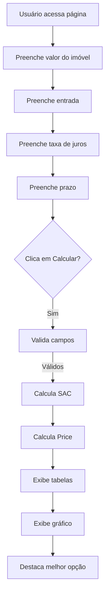

# PRD — Calculadora de Financiamento Imobiliário

**Versão:** 1.6  
**Data:** 31 de Outubro de 2026  
**Status:** v1.3, v1.4 (refatoração Sprints 13–18, 123 testes / 10 arquivos), v1.5 (Dockerização e Orquestração, Sprints 19–22) e v1.6 (Redesign baseado em `design_system/design-system.html`, Sprints 23–28) implementados e validados em 01/11/2026  

---

## 1. Resumo Executivo

Desenvolvimento de uma calculadora de financiamento imobiliário, funcionando como landing page responsiva, que permite ao usuário simular financiamentos pelos sistemas SAC e Price automaticamente, visualizar tabelas de amortização, comparar custos totais e identificar a opção mais econômica.

---

## 2. Objetivo do Produto

Fornecer uma ferramenta gratuita e acessível que auxilie o consumidor final a tomar decisões informadas sobre financiamento imobiliário, comparando automaticamente os dois sistemas de amortização mais comuns do mercado brasileiro.

---

## 3. Problema

O consumidor que deseja financiar um imóvel frequentemente não compreende a diferença entre os sistemas SAC e Price, nem consegue visualizar o impacto financeiro de cada um ao longo do tempo. Isso gera decisões subótimas e possível endividamento desnecessário.

---

## 4. Objetivos de Negócio

| Objetivo | Métrica | Meta |
|----------|---------|------|
| Utilidade pública | Visitas mensais | Crescente |
| Engajamento | Tempo na página | > 2 minutos |
| Compartilhamento | Shares via WhatsApp/link | Crescente |
| Retenção | Taxa de retorno | > 30% |

---

## 5. Escopo

### 5.1 Incluído (MVP)

- Formulário de entrada com 4 campos
- Cálculo automático dos dois sistemas (SAC e Price) ao clicar em "Calcular"
- Tabela de amortização completa para cada sistema
- 4 gráficos comparativos visuais (Parcelas, Juros, Amortização, Saldo Devedor)
- Comparação do valor total em R$
- Destaque do financiamento mais econômico
- Botão "Exportar CSV" para download dos dados das tabelas
- Paginação nas tabelas (20 itens por página quando houver mais de 20 linhas)
- Design responsivo (mobile-first)

### 5.2 Fora do Escopo

- Backend ou API
- Cadastro de usuários
- Autenticação
- Salvar simulações
- Integração com bancos ou APIs de taxas
- Simulação de correção monetária (INCC, TR)
- Cálculo de custos adicionais (ITBI, cartório, seguros)
- Exportação para formatos além de CSV (PDF, XLSX)

---

## 6. Stakeholders

| Stakeholder | Papel | Responsabilidade |
|-------------|-------|------------------|
| Product Manager | Decisor | Aprovação de requisitos e prioridades |
| Equipe Técnica | Executora | Desenvolvimento e manutenção |
| Designer UI/UX | Criação | Identidade visual e experiência |
| Marketing | Divulgação | Distribuição e métricas |

---

## 7. Personas

### 7.1 Pessoa — Consumidor Final

| Atributo | Descrição |
|----------|-----------|
| Nome | Maria Silva |
| Idade | 28-45 anos |
| Perfil | Pessoa física que deseja financiar imóvel |
| Necessidade | Compreender qual sistema de financiamento é mais vantajoso |
| Frustração | Dificuldade em comparar SAC e Price visualmente |
| Dispositivo | Predominantemente smartphone |

---

## 8. User Stories

| ID | Como... | Eu quero... | Para que... | Prioridade |
|----|---------|-------------|-------------|------------|
| US-001 | Usuário | Informar os dados do financiamento | Receber simulação completa | Must |
| US-002 | Usuário | Ver tabela SAC completa | Analisar parcelas mês a mês | Must |
| US-003 | Usuário | Ver tabela Price completa | Analisar parcelas mês a mês | Must |
| US-004 | Usuário | Comparar valores totais | Saber qual sistema é mais barato | Must |
| US-006 | Usuário | Compartilhar por WhatsApp | Enviar resultado para alguém | Should |
| US-007 | Usuário | Ler conteúdo educativo | Entender diferença SAC/Price | Could |
| US-008 | Usuário | Ver gráfico comparativo | Visualizar diferença visualmente | Should |
| US-009 | Usuário | Ver gráfico de evolução dos juros | Comparar custo de juros entre SAC e Price | Should |
| US-010 | Usuário | Ver gráfico de evolução da amortização | Entender como o principal é reduzido | Should |
| US-011 | Usuário | Ver gráfico de evolução do saldo devedor | Visualizar quitação ao longo do tempo | Should |
| US-012 | Usuário | Exportar dados em CSV | Analisar em planilhas (Excel/Google Sheets) | Should |
| US-013 | Usuário | Paginar tabelas longas | Visualizar dados de forma mais organizada | Should |

---

## 9. Casos de Uso

### UC-001 — Simular Financiamento

**Ator:** Usuário  
**Pré-condição:** Página carregada  
**Fluxo Principal:**
1. Usuário informa valor do imóvel
2. Usuário informa valor da entrada
3. Usuário informa taxa de juros mensal
4. Usuário informa prazo em meses
5. Usuário clica em "Calcular"
6. Sistema calcula automaticamente SAC e Price
7. Sistema exibe tabelas SAC e Price
8. Sistema exibe gráfico comparativo
9. Sistema destaca o financiamento mais econômico

**Fluxo de Exceção:**
- Campos obrigatórios vazios → exibir mensagem de erro
- Entrada maior ou igual ao valor do imóvel → exibir mensagem de erro
- Taxa de juros igual a zero → permitir cálculo (financiamento sem juros)

---

## 10. Fluxos de Negócio



---

## 11. Requisitos Funcionais

### 11.1 Formulário de Entrada

| ID | Requisito | Prioridade | Critério de Aceite |
|----|-----------|------------|-------------------|
| FR-001 | Campo "Valor do imóvel" (numérico, R$) | Must | Aceita valores > 0, formata moeda brasileira |
| FR-002 | Campo "Entrada" (numérico, R$) | Must | Aceita valores >= 20% do imóvel, < valor do imóvel |
| FR-003 | Campo "Taxa de juros" (numérico, % a.m.) | Must | Aceita valores >= 0, com até 2 casas decimais |
| FR-004 | Campo "Prazo" (numérico, meses) | Must | Aceita valores inteiros > 0, máximo 600 meses |
| FR-006 | Botão "Calcular" | Must | Executa cálculos e exibe resultados |

### 11.2 Cálculos

| ID | Requisito | Prioridade | Critério de Aceite |
|----|-----------|------------|-------------------|
| FR-010 | Cálculo SAC automático | Must | Amortização constante + juros sobre saldo devedor |
| FR-011 | Cálculo Price automático | Must | Parcelas fixas com juros amortizados |
| FR-012 | Cálculo ambos os sistemas | Must | Sempre calcula SAC e Price juntos |
| FR-013 | Valor financiado = Valor imóvel - Entrada | Must | Cálculo correto |
| FR-014 | Total pago = soma de todas as parcelas | Must | Inclui amortização + juros |
| FR-015 | Custo total dos juros = Total pago - Valor financiado | Must | Diferença correta |
| FR-016 | Geração de dados para CSV | Should | Gera string CSV com cabeçalhos: Mês, Amortização, Juros, Parcela, Saldo Devedor |

### 11.3 Resultados

| ID | Requisito | Prioridade | Critério de Aceite |
|----|-----------|------------|-------------------|
| FR-020 | Tabela SAC completa | Must | Mês, Amortização, Juros, Parcela, Saldo Devedor |
| FR-021 | Tabela Price completa | Must | Mês, Amortização, Juros, Parcela, Saldo Devedor |
| FR-022 | Comparação do valor total | Must | Exibe total SAC vs total Price em R$ |
| FR-023 | Destaque do mais econômico | Must | Indica visualmente qual sistema custa menos |
| FR-024 | Gráfico comparativo | Should | Barra ou linha mostrando evolução das parcelas |
| FR-025 | Compartilhar via WhatsApp | Should | Abre WhatsApp com mensagem formatada |
| FR-026 | Gráfico comparativo de juros | Should | Gráfico de linha mostrando evolução dos juros SAC vs Price |
| FR-027 | Gráfico comparativo de amortização | Should | Gráfico de linha mostrando evolução da amortização SAC vs Price |
| FR-028 | Gráfico comparativo de saldo devedor | Should | Gráfico de linha mostrando evolução do saldo devedor SAC vs Price |
| FR-029 | Botão exportar CSV | Should | Exporta dados de SAC e Price em formato CSV separado por ponto e vírgula |
| FR-030 | Paginação de tabelas | Should | Tabelas com paginação de 20 itens quando ultrapassar 20 linhas |

### 11.4 Conteúdo Educativo

| ID | Requisito | Prioridade | Critério de Aceite |
|----|-----------|------------|-------------------|
| FR-030 | Explicação SAC | Could | Texto claro sobre como funciona o SAC |
| FR-031 | Explicação Price | Could | Texto claro sobre como funciona o Price |
| FR-032 | Diferenças SAC vs Price | Could | Quadro comparativo textual |

### 11.5 Melhorias implementadas além do escopo inicial (v1.3)

| ID | Requisito | Critério de Aceite | Onde |
|----|-----------|-------------------|------|
| FR-033 | Ponto de equilíbrio SAC vs Price | Exibe "a partir do NNNº mês a parcela SAC fica menor que a Price" | `FinancingComparison.tsx` (`mesCruzamento`) |
| FR-034 | Percentual de economia | Exibe `-X,X%` ao lado da economia em R$ | `FinancingComparison.tsx` (`percentualEconomia`) |
| FR-035 | Taxa anual equivalente | Exibe `≈ X,XX% a.a.` a partir da taxa mensal | `FormCalculator.tsx` (`taxaAnualEquivalente`) |
| FR-036 | Atalhos de entrada e prazo | Botões 20/30/40/50% e 120/240/360/420m preenchem o campo | `FormCalculator.tsx` |
| FR-037 | Preview do valor financiado | Exibe `Valor a financiar (Principal)` + % do imóvel antes de calcular | `FormCalculator.tsx` (`valorFinanciadoPreview`) |
| FR-038 | Composição amortização/juros | Donut/texto `Amortização: X% / Juros: Y%` por sistema | `ResultHeader.tsx` |
| FR-039 | Lazy loading + animação de entrada | `Comparacao`/`Educativo` via `lazy`+`Suspense`, `FadeIn` | `App.tsx`, `ui/FadeIn.tsx` |

---

## 12. Requisitos Não Funcionais

| ID | Requisito | Prioridade | Critério de Aceite | Status em 22/10/2026 |
|----|-----------|------------|-------------------|----------------------|
| NFR-001 | Performance | Must | Cálculos em < 100ms no navegador | Não medido em runtime; build Vite em 153ms — remover meta ou medir com `performance.now()` |
| NFR-002 | Responsividade | Must | Funciona em telas de 320px a 2560px | Implementado (mobile-first, validado em 390px em 22/10/2026) |
| NFR-003 | Compatibilidade | Must | Chrome, Firefox, Safari, Edge (últimas 2 versões) | Não testado formalmente — pendente |
| NFR-004 | Acessibilidade | Should | Inputs com labels, contraste adequado | Implementado (`aria-label`, `tablist`, labels em `FormField`) — sem auditoria formal |
| NFR-005 | SEO | Could | Meta tags, título descritivo | Implementado (`index.html`: title, description, OG, Twitter, theme-color) |
| NFR-006 | Peso da página | Must | < 500KB total (sem imagens externas) | Atendido: `dist/` 464KB (22/10/2026). Obs: usa Google Fonts externas |

---

## 13. Regras de Negócio

| ID | Regra |
|----|-------|
| RN-001 | Entrada deve ser ≥ 20% e menor que o valor do imóvel |
| RN-002 | Taxa de juros pode ser zero (financiamento sem juros) |
| RN-003 | Prazo máximo de 600 meses (50 anos) |
| RN-004 | Valores monetários arredondados para 2 casas decimais |
| RN-005 | Tabelas devem mostrar todos os meses do prazo informado |
| RN-006 | O sistema mais econômico é o que menor valor total apresentar |

---

## 14. Modelo de Domínio

```
Financiamento
├── valorImovel: number
├── entrada: number
├── taxaJuros: number
├── prazoMeses: number
├── valorFinanciado: number
├── resultadoSAC: Resultado
└── resultadoPrice: Resultado

Resultado
├── totalPago: number
├── totalJuros: number
├── parcelaInicial: number
├── parcelaFinal: number
└── tabela: Parcela[]

Parcela
├── mes: number
├── amortizacao: number
├── juros: number
├── parcela: number
└── saldoDevedor: number
```

---

## 15. Integrações

Nenhuma integração externa necessária. Todos os cálculos são realizados localmente no navegador.

---

## 16. APIs

Não aplicável — aplicação 100% frontend.

---

## 17. Modelo de Dados Conceitual

```
┌─────────────────────────────────────────────┐
│              ENTRADA                        │
├─────────────────────────────────────────────┤
│  valorImovel: R$ X.XXX,XX                   │
│  entrada: R$ X.XXX,XX                       │
│  valorFinanciado: R$ X.XXX,XX               │
│  taxaJuros: X,XX% a.m.                      │
│  prazoMeses: XXX meses                      │
└─────────────────────────────────────────────┘
                    │
                    ▼
┌─────────────────────────────────────────────┐
│              RESULTADO                      │
├─────────────────────────────────────────────┤
│  SAC                                        │
│  ├── totalPago: R$ X.XXX,XX                 │
│  ├── totalJuros: R$ X.XXX,XX                │
│  └── tabela: [Parcela, ... Parcela]         │
├─────────────────────────────────────────────┤
│  PRICE                                      │
│  ├── totalPago: R$ X.XXX,XX                 │
│  ├── totalJuros: R$ X.XXX,XX                │
│  └── tabela: [Parcela, ... Parcela]         │
├─────────────────────────────────────────────┤
│  COMPARAÇÃO                                 │
│  ├── melhorOpcao: SAC | PRICE               │
│  └── economia: R$ X.XXX,XX                  │
└─────────────────────────────────────────────┘
```

---

## 18. Permissões

Não aplicável — não há autenticação ou perfis de usuário.

---

## 19. Critérios de Aceite

| ID | Critério |
|----|----------|
| CA-001 | Formulário valida campos obrigatórios antes de calcular |
| CA-002 | Tabela SAC exibe todos os meses com valores corretos |
| CA-003 | Tabela Price exibe todos os meses com valores corretos |
| CA-004 | Comparação mostra valores totais lado a lado |
| CA-005 | Sistema mais econômico é destacado visualmente |
| CA-007 | Compartilhar abre WhatsApp com mensagem formatada |
| CA-008 | Página funciona em dispositivos móveis |
| CA-009 | Cálculos são precisos (comparação com planilha de referência) |
| CA-010 | Gráfico de juros exibe evolução correta SAC vs Price |
| CA-011 | Gráfico de amortização exibe evolução correta SAC vs Price |
| CA-012 | Gráfico de saldo devedor exibe evolução correta SAC vs Price |
| CA-013 | Botão CSV exporta dados corretos de ambas as tabelas |
| CA-014 | Paginação funciona corretamente com 20 itens por página |
| CA-015 | CSV gerado é válido e pode ser importado em Excel/Google Sheets |

---

## 20. MVP

### Versão 1.0 (MVP)

- Formulário com 4 campos
- Cálculo automático SAC + Price
- Botão Calcular
- Tabelas completas para ambos os sistemas
- 4 gráficos comparativos (Parcelas, Juros, Amortização, Saldo Devedor)
- Comparação do valor total
- Destaque do mais econômico
- Botão exportar CSV (ambas as tabelas)
- Paginação de tabelas (20 itens por página)
- Design responsivo

### Versão 1.1

- Compartilhar via WhatsApp
- Conteúdo educativo

### Versão 1.2

- Animações de transição
- SEO otimizado
- Analytics

---

## 21. Roadmap

| Fase | Entregas | Estimativa |
|------|----------|------------|
| Fase 1 — MVP | Estrutura HTML + CSS + JS, formulário, cálculos, tabelas, comparação | Sem prazo definido |
| Fase 2 — Extras | Gráficos, compartilhamento, conteúdo educativo | Sem prazo definido |
| Fase 3 — Polish | Animações, SEO, analytics | Sem prazo definido |

---

## 22. Métricas de Sucesso

| Métrica | Indicador | Meta |
|---------|-----------|------|
| Utilidade | Visitas mensais | Crescente |
| Engajamento | Tempo médio na página | > 2 minutos |
| Precisão | Acerto dos cálculos | 100% |
| Compartilhamento | Shares via WhatsApp | Crescente |
| Retorno | Taxa de retorno | > 30% |

---

## 23. Riscos

| Risco | Impacto | Probabilidade | Mitigação |
|-------|---------|---------------|-----------|
| Erro nos cálculos financeiros | Alto | Média | Validação com planilha de referência |
| Incompatibilidade entre browsers | Médio | Baixa | Testes nos 4 browsers principais |
| Performance em prazos longos (600 meses) | Baixo | Baixa | Otimização de loops |
| UX confusa em mobile | Médio | Média | Testes de usabilidade |

---

## 24. Dependências

| Dependência | Tipo | Status |
|-------------|------|--------|
| Biblioteca de gráficos (Chart.js) | Externa | Obrigatória (Fase 1) |
| Geração de CSV | Interna | Obrigatória (Fase 1) |

---

## 25. Dívidas Técnicas

| Item | Status em 22/10/2026 |
|------|----------------------|
| 31 arquivos modificados não commitados + 5 paths untracked (`public/og-image.svg`, `__tests__/`, `test/`, `docs/`) | Pendente — fazer commit por sprint ou squash com mensagem por escopo |
| `typescript: ~6.0.2` (versão fora do stable público) + churn em `package-lock.json` (1658 linhas) | Pendente — avaliar pinagem em TS 5.x |
| NFR-001/NFR-003 sem evidência formal (performance runtime, cross-browser) | Pendente — medir e registrar |

---

## 26. Dúvidas em Aberto

| Dúvida | Status |
|--------|--------|
| Usar Chart.js ou gráfico customizado em CSS? | Resolvido — Chart.js + react-chartjs-2 (`LineChart.tsx`) |
| Compartilhar via link externo ou apenas WhatsApp? | Resolvido — apenas WhatsApp (`WhatsAppShareButton.tsx`) |
| Necessário testar em navegadores antigos? | Resolvido — escopo: últimas 2 versões (NFR-003, sem teste formal ainda) |

---

## 27. Fórmulas de Cálculo

### SAC (Sistema de Amortização Constante)

```
Amortização = Valor Financiado / Prazo
Juros = Saldo Devedor * Taxa Mensal
Parcela = Amortização + Juros
Saldo Devedor = Saldo Anterior - Amortização
```

### Price (Tabela Price)

```
Parcela = VP * [i * (1+i)^n] / [(1+i)^n - 1]
Onde:
  VP = Valor Financiado
  i = Taxa mensal
  n = Prazo em meses
```

### Geração de CSV

**Estrutura do arquivo:**
- Separador: ponto e vírgula (;)
- Encoding: UTF-8
- Cabeçalhos: Mês, Amortização, Juros, Parcela, Saldo Devedor
- Separador decimal: vírgula (,) para compatibilidade brasileira
- Separador de milhar: ponto (.)

**Seções no arquivo:**
1. SAC — TABELA DE AMORTIZAÇÃO
2. PRICE — TABELA DE AMORTIZAÇÃO

---

## Checklist de Completude

- [x] Resumo Executivo
- [x] Objetivo do Produto
- [x] Problema
- [x] Objetivos de Negócio
- [x] Escopo
- [x] Fora do Escopo
- [x] Stakeholders
- [x] Personas
- [x] User Stories
- [x] Casos de Uso
- [x] Fluxos de Negócio
- [x] Requisitos Funcionais
- [x] Requisitos Não Funcionais
- [x] Regras de Negócio
- [x] Modelo de Domínio
- [x] Integrações
- [x] APIs
- [x] Modelo de Dados Conceitual
- [x] Permissões
- [x] Critérios de Aceite
- [x] MVP
- [x] Roadmap
- [x] Métricas de Sucesso
- [x] Riscos
- [x] Dependências
- [x] Dívidas Técnicas
- [x] Dúvidas em Aberto
- [x] Fórmulas de Cálculo
- [x] Gráficos adicionais (juros, amortização, saldo devedor)
- [x] Exportação CSV
- [x] Paginação de tabelas
- [x] Plano de refatoração e modularização (v1.4, sem mudança funcional)
- [x] Plano de Dockerização e Orquestração (v1.5, Sprints 19–22)
- [x] Plano de Redesign Visual — NectArr Design System (v1.6, Sprints 23–28)

---

## 28. Plano de Refatoração e Modularização (v1.4 — sem mudança funcional)

**Motivador (decisão 22/10/2026):** manutenibilidade. **Escopo:** só refatoração segura — nenhuma mudança visual/comportamental. **Estratégia:** incremental por fases, cada fase reversível e coberta por testes. Detalhamento executável em `SPRINTS.md` (Sprints 13–18 — **concluídas**).

### 28.1 Diagnóstico (base: auditoria 22/10/2026, ~2.262 linhas sem testes)

| Achado | Onde | Impacto |
|--------|------|---------|
| Lógica derivada dentro de UI (sem cobertura) | `FinancingComparison.tsx:19-37` (`mesCruzamento`, `%economia`), `ResultHeader.tsx:19-25` (`principal`), `FormCalculator.tsx:34-62` (`taxaAnual`, `prazoAnos`, `preview`, `%entrada`) | Baixa testabilidade, risco de divergência |
| Parsing de moeda/percentual duplicado (6 ocorrências) | `useFormCalculator.ts:37-38,157-158` + `FormCalculator.tsx:29-31` | Drift de formato; gotcha máscara `/100` (`format.ts`) |
| Validação acoplada a formatação | `useFormCalculator.ts:53` chama `formatarEntradaMoeda()` dentro de `validate()`; `handleChange:104-118` vs `handleBlur:126-142` quase idênticas | Teste frágil, validador não reutilizável |
| Componentes grandes (>200 linhas) | `EducationalContent.tsx:286`, `FinancingComparison.tsx:244`, `FormCalculator.tsx:228` (+ `PainelSAC` vs `PainelPrice` JSX idêntico) | Difícil revisar/testar |
| Anti-patterns isolados | `AmortizationTable.tsx:17-20` (`setState` durante render), `LineChart.tsx:17-26,90-167` (`ChartJS.register()` em módulo + `options` ignora `rotuloEixoY`), `InputField` com `forwardRef` legado (desnecessário no React 19) | Extra render em `StrictMode`, prop morta |
| Mistura puro/impuro + over-segmentação | `csv.ts:46` (`downloadCSV` com DOM junto da geração), `sharing/` com 1 arquivo de 60 linhas, barrels inconsistentes | Dificulta mock/teste |

### 28.2 Princípios e restrições globais (valem para Sprints 13–18)

- Fluxo mantido: `components → hooks → utils → types`, sem ciclos. `components` só renderizam; todo cálculo vai para `utils/` puro.
- Regras de negócio imutáveis: entrada ≥ 20% e < valor (RN-001), taxa 0–20%/mês, prazo 1–600 (RN-002/RN-003), arredondamento 2 casas com ajuste na última parcela (RN-004), CSV pt-BR `;` + `,` + `BOM \uFEFF` + seções `SAC —/Price —`.
- Load-bearing intocável sem migração dedicada: `vite.config.ts` (`globals:true`, `jsdom`, `setupFiles:./src/test/setup.ts`, `css:true`), máscara `/100`, mensagens pt-BR.
- Núcleo `calculations.ts` (SAC/Price/Totais/comparar) não muda na refatoração; invariantes travadas: `parcela = amort + juros`, `total - juros = principal`, `SAC.juros < Price.juros`.
- Comandos de verificação por fase (em `calculadora-fi/`): `npx vitest run <escopo>`, `npm run lint`, `npm run format:check`, `npm run build` (`tsc -b && vite build`).

### 28.3 Arquitetura-alvo (sem mudar UX)

```text
src/
  constants/business.ts      # ENTRADA_MINIMA=0.2, TAXA_MAXIMA=20, PRAZO_MAXIMO=600, ITENS_POR_PAGINA=20, atalhos
  utils/
    format.ts               # + parseMoedaParaNumero(), parsePercentualParaNumero(), formatarPercentual()
    calculations.ts             # inalterado no núcleo
    analysis.ts              # NOVO puro: mesCruzamento(), percentualEconomia(), valorPrincipal(), taxaAnualEquivalente(), prazoEmAnos(), percentualEntrada()
    csv.ts                  # só geração pura; downloadCSV → csvDownload.ts (DOM)
    chart.ts                # NOVO: cores SAC/PRICE + chartOptions() + registerChart()
  domain/validation.ts       # NOVO puro: validateFinanciamento(números) sem máscara/formatação
  components/
    form/ (container + CamposFormulario + DownPaymentShortcuts/TermShortcuts + PrincipalPreview)
    results/ (FinancingComparison orquestra + RecommendationCard + ChartsGrid + TableTabs)
    education/ (content.ts + SystemPanel unificado + ComparisonTable + EducationTabs)
    layout/ + SimulationCard.tsx (extraído de App.tsx:32-58)
```

### 28.4 Fases (resumo; tarefas e DoD em SPRINTS.md)

| Fase | Sprint | Entrega |
|------|--------|---------|
| Fase 0 — Trava de segurança | Sprint 13 | Testes de caracterização do comportamento atual (sem código produtivo) |
| Fase 1 — Derivados puros | Sprint 14 | `utils/analysis.ts` + testes; UI consome (remove lógica de `Comparacao/ResultadoHeader/Form`) |
| Fase 2 — Parsing único | Sprint 15 | `parseMoeda/Percentual` em `format.ts`; substitui 6 ocorrências + `toLocaleString` ad-hoc |
| Fase 3 — Validação pura | Sprint 16 | `constants/business.ts` + `domain/validation.ts`; hook vira adaptador fino |
| Fase 4 — Fatiar componentes + 2 bugfixes seguros | Sprint 17 | Sub-componentes + `useEffect` em `Tabela` + `options` do `Grafico` + sem `forwardRef` |
| Fase 5 — Higiene | Sprint 18 | Barrels consistentes, split `csv`, `chart.ts`, `sharing`, `oxlint`, limpeza `user-event` se morto |

### 28.5 Requisitos de refatoração

| ID | Requisito | Critério de aceite |
|----|-----------|-------------------|
| RFR-001 | Nenhuma mudança visual/funcional | Screenshots e fluxos US-001–US-013 inalterados; testes existentes continuam passando sem ajuste de snapshot |
| RFR-002 | Lógica derivada 100% em funções puras testadas | `mesCruzamento`, `%economia`, `principal`, `taxaAnual`, `prazoAnos`, `preview` cobertos em `analysis.test.ts` |
| RFR-003 | Parsing centralizado | Uma única implementação de parse moeda/percentual; zero ocorrências de `replace(/\./g,'')` fora de `format.ts` |
| RFR-004 | Validação pura reutilizável | `validateFinanciamento` sem importar `format.ts`; mensagem formatada injetada pelo hook |
| RFR-005 | Componentes ≤ ~150 linhas cada (alvo) | `Comparacao/Form/Educativo` fatiados; nenhum arquivo novo >150 linhas sem justificativa |
| RFR-006 | Sem `setState` durante render | `TabelaAmortizacao` usa `useEffect` ou `key`; sem warning em `StrictMode` |

### 28.6 Riscos

| Risco | Mitigação |
|-------|-----------|
| Quebrar arredondamento/invariantes | Fase 1 não toca núcleo; caracterização trava totais antes |
| Mensagem de erro com formato quebra teste | Validador recebe número; hook formata |
| Canvas `chart.js` quebra `jsdom` | Sem teste de canvas novo; manter `memo/useMemo` |

---

## 29. Plano de Dockerização e Orquestração (v1.5 — Containerização)

**Motivador (decisão 22/10/2026):** portabilidade, reprodutibilidade de ambiente (dev, teste/lint e produção) e deploy padronizado como container imutável. **Escopo:** containerização multi-stage da aplicação frontend em `calculadora-fi/` e orquestração via Docker Compose na raiz do repositório, sem alterar regras de negócio ou interface. Detalhamento executável em `SPRINTS.md` (Sprints 19–22).

### 29.1 Diagnóstico Técnico para Containerização

| Aspecto | Situação no Repositório | Impacto na Dockerização |
|---------|-------------------------|-------------------------|
| Topologia de pastas | Raiz contém documentação (`PRD.md`, `SPRINTS.md`, `README.md`, `docs/`); app vive isolado em `calculadora-fi/` | `Dockerfile` e `.dockerignore` ficam em `calculadora-fi/`; `docker-compose.yml` fica na raiz com `context: ./calculadora-fi` |
| Natureza da aplicação | 100% SPA estática client-side (sem backend, sem banco de dados, sem `import.meta.env` / `process.env`) | Imagem final de produção não precisa de Node.js; apenas Nginx servindo os estáticos de `dist/` (~460 KB) |
| Requisitos de Node.js | Vite `^8.1.1` e pacotes CSS exigem `node: ^20.19.0 \|\| ^22.12.0 \|\| >=24.0.0` | Uso obrigatório de `node:22-alpine` (LTS) nos estágios de build, dev e check |
| Binários nativos (Rust) | `rolldown` (Vite 8), `@tailwindcss/oxide`, `lightningcss` e `oxlint` usam bindings nativos | `package-lock.json` já inclui `optionalDependencies` para `linux-*-musl`; `npm ci` dentro do container Alpine instala os binários corretos |
| Artefatos locais existentes | `calculadora-fi/node_modules/` e `calculadora-fi/dist/` existem no disco local | Obrigatório `.dockerignore` rigoroso para não vazar binários `glibc` do host nem invalidar o cache de camadas do Docker |
| Rede no modo Dev (HMR) | `vite` por padrão escuta apenas em `127.0.0.1:5173` | No container `dev`, é necessário passar `--host 0.0.0.0` para permitir acesso via port-forwarding |

### 29.2 Decisões Arquiteturais (ADRs)

1. **ADR-01 — Imagem Base de Build (`node:22-alpine`):** Atende com folga o requisito de engine do Vite 8 (`^22.12.0`), reduz drasticamente o tamanho das camadas intermediárias e é compatível com os pacotes `-musl` já mapeados no `package-lock.json`.
2. **ADR-02 — Servidor de Produção (`nginxinc/nginx-unprivileged:stable-alpine`):** Substitui `vite preview` (não recomendado para produção) por um servidor Nginx oficial que roda sem privilégios de `root` (UID `101`, porta interna `8080`), gerando uma imagem final enxuta (~25,7 MB `CONTENT SIZE` comprimido / ~90,8 MB `DISK USAGE`) e segura.
3. **ADR-03 — Porta Padrão Parametrizável (`${PORT:-8080}:8080`):** Expõe por padrão em `http://localhost:8080` (evitando conflito com portas privilegiadas `<1024`, `5173` do Vite dev e `3000`), permitindo sobrescrita imediata via variável de ambiente (`PORT=3000 docker compose up -d`).
4. **ADR-04 — Estágio de Qualidade (`check`) Desacoplado do `builder`:** O comando `npm run build` já executa `tsc -b && vite build` (garantindo checagem estrita de tipos no build de produção). O estágio `check` (OxLint + Prettier + 123 testes Vitest/jsdom) fica disponível no mesmo `Dockerfile` herdando o cache de `base`, podendo ser executado sob demanda ou em CI (`docker compose --profile test run --rm --build test`) sem penalizar o tempo de build de produção.
5. **ADR-05 — Orquestração na Raiz (`docker-compose.yml`):** Posicionado na raiz do projeto apontando para `./calculadora-fi`, permitindo subir produção (`app`), desenvolvimento com HMR (`dev`) ou suíte de testes (`test`) diretamente da raiz do repositório.

### 29.3 Arquitetura Multi-Stage e Estrutura de Arquivos

```text
[base: node:22-alpine] (WORKDIR /app + package*.json + npm ci com cache de camada)
   ├──► [dev]     → CMD: npm run dev -- --host 0.0.0.0 (porta 5173, HMR via bind mounts)
   ├──► [check]   → CMD: npm run lint && npm run format:check && npm run test (123 testes)
   └──► [builder] → RUN: npm run build (tsc -b && vite build → gera /app/dist)
           │
           ▼
[prod: nginxinc/nginx-unprivileged:stable-alpine]
   └── Copia nginx.conf + /app/dist → /usr/share/nginx/html (non-root, porta 8080, HEALTHCHECK)
```

**Arquivos do escopo v1.5:**

```text
.
├── docker-compose.yml               # NOVO: Serviços app (prod), dev (profile dev) e test (profile test)
├── README.md                        # MODIFICADO: Instruções de execução com Docker
└── calculadora-fi/
    ├── .dockerignore                # NOVO: Exclui node_modules, dist, coverage, logs, .git, IDEs
    ├── Dockerfile                   # NOVO: Multi-stage (base, dev, check, builder, prod)
    ├── nginx.conf                   # NOVO: SPA fallback, cache imutável /assets/, gzip, security headers
    └── README.md                    # MODIFICADO: Comandos Docker resumidos
```

### 29.4 Requisitos de Containerização

| ID | Requisito | Prioridade | Critério de Aceite |
|----|-----------|------------|-------------------|
| DKR-001 | Higiene de contexto Docker | Must | `.dockerignore` impede envio de `node_modules/`, `dist/`, `coverage/`, `.git/` e logs ao daemon |
| DKR-002 | Stage `base` com cache de dependências | Must | `node:22-alpine` executa `npm ci` copiando apenas `package.json` e `package-lock.json` antes do código-fonte |
| DKR-003 | Stage `dev` com HMR em container | Should | `npm run dev -- --host 0.0.0.0` acessível em `http://localhost:5173` com recarregamento ao editar `src/` |
| DKR-004 | Stage `check` isolado para qualidade | Should | Executa `npm run lint && npm run format:check && npm run test` (123 testes passando em container) |
| DKR-005 | Stage `builder` de produção | Must | Executa `npm run build` (`tsc -b && vite build`) gerando `/app/dist` sem erros |
| DKR-006 | Stage `prod` seguro e otimizado | Must | `nginxinc/nginx-unprivileged:stable-alpine` na porta `8080`, non-root, `gzip on`, cache `1y immutable` para `/assets/`, `no-cache` para `/index.html`, headers de segurança (`X-Content-Type-Options`, `X-Frame-Options`, `Referrer-Policy`, `server_tokens off`) e `HEALTHCHECK` funcional |
| DKR-007 | Orquestração via Docker Compose | Must | `docker-compose.yml` na raiz com serviço padrão `app` (`${PORT:-8080}:8080`) e perfis `dev` e `test` |
| DKR-008 | Documentação atualizada | Must | `README.md`, `calculadora-fi/README.md` e `AGENTS.md` documentam os fluxos Docker |

### 29.5 Riscos e Mitigações (Dockerização)

| Risco | Impacto | Probabilidade | Mitigação |
|-------|---------|---------------|-----------|
| Vazamento de `node_modules` do host (glibc) para o container (musl) | Alto (falha nos bindings Rust `rolldown`/`oxide`/`oxlint`) | Média | `.dockerignore` bloqueia `node_modules` no build; volume anônimo `/app/node_modules` ou bind seletivo de `./calculadora-fi/src` no Compose `dev` |
| Cache de navegador retendo `index.html` antigo após novo deploy | Médio (usuário tenta baixar chunks JS com hash antigo) | Média | `nginx.conf` define `Cache-Control: no-cache` para `/index.html` e `public, max-age=31536000, immutable` apenas para `/assets/` |
| Permissão negada ao rodar Nginx como usuário non-root | Alto (container não inicia se tentar usar porta 80 ou `/var/cache/nginx` restrito) | Baixa | Uso da imagem oficial `nginxinc/nginx-unprivileged:stable-alpine` pré-configurada para UID `101` e porta `8080` |
| Vite Dev Server inacessível fora do container | Médio (`Connection reset` no host) | Alta (se omitido flag) | Passar `--host 0.0.0.0` explicitamente no `CMD` do stage `dev` |

---

## 30. Plano de Redesign Visual — NectArr Design System (v1.6)

**Motivador (decisão 31/10/2026):** modernização completa da identidade visual e da experiência de interface da Calculadora de Financiamento Imobiliário com base fiel na biblioteca de padrões viva `design_system/design-system.html` (*NectArr — Design System*). **Escopo:** substituição integral da antiga temática `slate/blue/emerald` e fontes `Inter`/`Plus Jakarta Sans` pela linguagem visual NectArr (`Geist` + `Montserrat`, superfícies `neutral`/`stone`, acentos **Brand Lime `#c1ff72`** e **Deep Navy `#002f43`**, `.glass-panel`, `.grid-lines`, `.spotlight-card`, `.glass-button` e animações `clip-in`/`fade-up`/`float`), preservando 100% das regras de negócio, acessibilidade e cobertura dos 123 testes automatizados. Detalhamento executável etapa por etapa em `SPRINTS.md` (Sprints 23–28).

### 30.1 Diagnóstico Visual (Estado Atual v1.5 vs Referência `design-system.html`)

| Dimensão | Estado Atual (v1.5) | Alvo do Redesign (v1.6 — `design-system.html`) |
|----------|---------------------|------------------------------------------------|
| **Tipografia** | `Inter` (corpo) + `Plus Jakarta Sans` (títulos) | `Geist` (corpo, números tabulares e display `.font-google-sans-flex` com `letter-spacing: -0.04em`) + `Montserrat` (headings `h2`/`h3`, labels uppercase, parágrafos de apoio e navegação) |
| **Fundo e Superfícies** | `bg-slate-50` liso; cards `bg-white border-slate-200 rounded-2xl`; header/footer `bg-slate-900` | `bg-neutral-100` (`#f5f5f5`) com grade arquitetônica fixa `.grid-lines` (`40px`, `rgba(0,0,0,0.03)`); header `.glass-panel` (`blur(16px)`); seções/cards `bg-white` (`rounded-[32px]` / `rounded-2xl`) e `bg-neutral-50` (`#fafafa`) com `border-stone-200`; superfícies de destaque em `bg-stone-900`, `bg-[#002f43]` e `bg-[#c1ff72]` |
| **Paleta Semântica (SAC vs Price)** | SAC em `emerald-600` (`#059669`) e Price em `blue-600` (`#2563eb`) sobre neutros frios `slate-*` | Neutros quentes `stone-*` / `neutral-*`; **SAC** assume a identidade **Brand Lime** (`#c1ff72`, `lime-300`, `lime-100/80`, linha gráfica `#65a30d`) e **Price** assume a identidade **Deep Navy / Sky** (`#002f43`, `sky-50`, `sky-100`, linha gráfica `#002f43`) |
| **Botões e CTAs** | Botão retangular `bg-blue-600 rounded-xl` e WhatsApp `bg-emerald-600 rounded-xl` | Botões pílula (`rounded-full`) e técnicos (`rounded-lg`/`rounded-xl`): CTA primário `.glass-button` com `.button-shine` ou `bg-stone-900 text-[#c1ff72] hover:bg-stone-800`, e CTA de destaque `bg-[#c1ff72] hover:bg-[#b0f060] text-stone-900 shadow-lg hover:shadow-[0_0_20px_rgba(193,255,114,0.3)]` |
| **Motion e Microinterações** | Apenas `animate-fadeIn` (`0.35s`) | `animate-clip-in` (`1.2s cubic-bezier(0.25,1,0.5,1)`), `animate-fade-up` (`0.8s`), `animate-float` (`6s`), `animate-pulse-slow`, `.spotlight-card` (brilho radial de `800px` que acompanha `--mouse-x`/`--mouse-y`) e `.button-shine` |

### 30.2 Mapeamento de Tokens Visuais (`design-system.html` → `calculadora-fi`)

#### 1. Tipografia (`01 — Typography`)

| Token / Estilo | Fonte e Classes no Design System | Aplicação no CFI |
|----------------|----------------------------------|------------------|
| **Body / Números** | `.font-geist` (`'Geist', sans-serif`) + `.tabular-nums` | Corpo da página (`<body>`), inputs, células de tabelas, valores em R$ e eixos dos gráficos |
| **Display Accent** | `.font-google-sans-flex` (`'Geist', sans-serif; letter-spacing: -0.04em`) | Wordmark `CFI` no Header/Footer e palavra-chave destacada no título do simulador com sublinhado curvo SVG em `#c1ff72` |
| **Heading 1 (Hero / Simulador)** | `leading-[0.95] text-4xl sm:text-5xl lg:text-6xl font-medium text-stone-900 tracking-tighter` | Cabeçalho principal do `SimulacaoCard` / seção de abertura |
| **Heading 2 (Títulos de Seção)** | `text-2xl sm:text-3xl lg:text-4xl font-medium text-stone-900 tracking-tight font-montserrat` | Títulos de "Análise Gráfica Comparativa" e "Entenda os Sistemas de Financiamento" |
| **Heading 3 · Stats (KPIs)** | `text-2xl sm:text-3xl lg:text-4xl font-semibold tracking-tighter text-stone-900 tabular-nums` | Valores monetários principais em `ResultadoHeader`, `CartaoRecomendacao` e `PreviewPrincipal` |
| **Heading 3 · Card** | `text-xl lg:text-2xl font-bold text-stone-900 font-montserrat` | Títulos internos dos painéis (`PainelSistema`, `TabelaComparativa`, `CartaoRecomendacao`) |
| **Paragraph L / M** | `font-montserrat text-stone-500 leading-relaxed text-base lg:text-lg` / `text-sm lg:text-base` | Subtítulos de seção e textos explicativos do conteúdo educativo |
| **Label / Eyebrow** | `font-semibold text-xs tracking-widest uppercase block text-stone-900 bg-stone-100 w-fit px-3 py-1.5 rounded` ou `text-[#c1ff72] font-mono text-xs uppercase tracking-wider` | Tags de seção ("Guia de Decisão", "Análise Visual", "Fórmula de Cálculo") |

#### 2. Cores e Superfícies (`02 — Colors & Surfaces`)

| Token | Valor / Classe | Uso no CFI |
|-------|----------------|------------|
| **Brand Lime** | `#c1ff72` (`bg-[#c1ff72]`, hover `bg-[#b0f060]`, border `#aae65f`) | Cor de marca, seleção de texto (`selection:bg-[#c1ff72]`), badges de economia, indicadores pulsantes, destaques SAC e CTAs |
| **Deep Navy** | `#002f43` (`bg-[#002f43]`, `text-[#002f43]`) | Identidade visual da Tabela Price (badges, abas ativas, série gráfica Price e acentos secundários) |
| **Ink / Dark Surface** | `stone-900` (`#1c1917`), `stone-800` (`#292524`) | Textos principais, botões primários escuros (`bg-stone-900 text-[#c1ff72]`), bloco de fórmula matemática e tooltips |
| **Page Surface** | `bg-neutral-100` (`#f5f5f5`) + `.grid-lines` | Plano de fundo geral da aplicação |
| **Section / Card Surface** | `bg-white` (`#ffffff`) + `border-stone-200` | Containers principais (`SimulacaoCard`, `ResultadoHeader`, `LineChart`, `AmortizationTable`, `EducationalContent`) |
| **Panel Surface** | `bg-neutral-50` (`#fafafa`) + `border-stone-200` | Células de KPI, barras de cabeçalho de tabelas, rodapé de paginação e container do `Footer` |
| **Glass Panel** | `.glass-panel` (`rgba(255,255,255,0.6)`, `backdrop-filter: blur(16px)`, `border: 1px solid rgba(255,255,255,0.5)`) | `Header` fixo/sticky no topo e cards flutuantes/destaques |
| **Bento Mint / Sky Surfaces** | `bg-lime-100/80 border-lime-200` (SAC) e `bg-sky-50 border-sky-100` (Price) | Superfícies temáticas de recomendação e destaques comparativos |

### 30.3 Derivação Fiel para Inputs e Estados de Formulário

Conforme documentado na seção `03 — Components` do `design-system.html` (*"A página de referência não contém inputs, selects ou textareas — seção de estados de formulário omitida por fidelidade"*), os campos de formulário da calculadora devem ser **derivados estritamente dos tokens existentes na página**, sem inventar cores ou famílias alheias ao sistema:

1. **Container do Campo (`InputField.tsx`):**
   - Superfície padrão: `bg-neutral-50 border border-stone-200 rounded-xl text-stone-900 font-geist tabular-nums placeholder:text-stone-400`.
   - Hover: `hover:border-stone-300 hover:bg-white`.
   - Focus: `focus:bg-white focus:outline-none focus:ring-2 focus:ring-[#c1ff72]/60 focus:border-stone-900`.
   - Erro de validação: preserva semântica de alerta acessível (`border-red-400 bg-red-50/30 focus:ring-red-500/20 focus:border-red-500` e texto `text-red-600`).
2. **Labels, Prefixos/Sufixos e Badges de Campo:**
   - Label: `font-montserrat text-sm font-semibold text-stone-800`.
   - Prefixo/Sufixo (`R$`, `%`): `text-stone-400 font-semibold text-sm`.
   - Badge auxiliar (`% entrada`, `≈ % a.a.`, `anos`): `text-xs font-medium px-2.5 py-0.5 rounded-md bg-stone-100 text-stone-700 border border-stone-200 tabular-nums`.
3. **Atalhos Rápidos (`DownPaymentShortcuts.tsx`, `TermShortcuts.tsx`):**
   - Pílula ativa: `bg-stone-900 text-[#c1ff72] border border-stone-900` (token do botão primário do Header NectArr).
   - Pílula inativa: `bg-stone-100 text-stone-600 border border-stone-200 hover:bg-stone-200 hover:text-stone-900`.
   - Pílula desabilitada (`valorImovel <= 0`): `bg-stone-100 text-stone-400 border border-stone-200/60 cursor-not-allowed`.
4. **Preview do Principal (`PrincipalPreview.tsx`):**
   - Estilizado como o *Pattern C — Stats* e *Notification Card* do Hero: `rounded-2xl bg-neutral-50 border border-stone-200 px-5 py-3.5` com dot `w-2.5 h-2.5 rounded-full bg-[#c1ff72] border border-lime-600` e valor principal em `text-lg font-semibold tracking-tighter text-stone-900 tabular-nums`.
5. **Botão "Calcular" (`FormCalculator.tsx`):**
   - Habilitado (`isValid === true`): botão pílula `rounded-full` combinando o token primário NectArr (`bg-stone-900 text-[#c1ff72] hover:bg-stone-800 shadow-lg hover:shadow-[0_0_20px_rgba(193,255,114,0.25)]` com `.button-shine` sutil).
   - Desabilitado (`isValid === false`): `bg-stone-200 text-stone-400 rounded-full cursor-not-allowed`.

### 30.4 Especificação por Componente e Seção

```text
calculadora-fi/
├── index.html                                    # Fontes Geist + Montserrat; theme-color #1c1917
├── public/
│   ├── favicon.svg                               # Atualizado para paleta #1c1917 + #c1ff72 + #002f43
│   └── og-image.svg                              # Atualizado para identidade NectArr
└── src/
    ├── index.css                                 # @theme / utilitários: .glass-panel, .grid-lines, .spotlight-card, .glass-button, animações
    ├── App.tsx                                   # bg-neutral-100 + .grid-lines fixo + selection:bg-[#c1ff72]
    ├── utils/
    │   ├── chart.ts                              # COR_SAC (#65a30d / lime fill) + COR_PRICE (#002f43 / navy fill) + Geist tooltip
    │   └── spotlight.ts                          # NOVO helper: handleSpotlightMouseMove para atualizar --mouse-x / --mouse-y
    └── components/
        ├── layout/
        │   ├── Header.tsx                        # .glass-panel sticky, wordmark CFI font-google-sans-flex, pill status #c1ff72
        │   ├── Main.tsx                          # Container max-w-6xl px-4 sm:px-6 lg:px-12 relative z-10
        │   ├── SimulationCard.tsx                # Hero header editorial + sublinhado curvo SVG #c1ff72 + surface rounded-[32px]
        │   └── Footer.tsx                        # Card rounded-3xl bg-neutral-50 border-stone-200 p-8 lg:p-12
        ├── ui/
        │   ├── InputField.tsx / FormField.tsx    # Tokens stone/neutral + focus ring #c1ff72/stone-900
        │   ├── Pagination.tsx                    # Barra bg-neutral-50 border-stone-200 + botões hover stone-900/#c1ff72
        │   └── FadeIn.tsx                        # Suporte a animate-fade-up / animate-clip-in com motion-reduce
        ├── form/
        │   ├── FormCalculator.tsx                # Grid de campos + botão Calcular rounded-full stone-900/#c1ff72
        │   ├── DownPaymentShortcuts.tsx          # Pílulas stone-900 text-[#c1ff72] (ativo) / stone-100 (inativo)
        │   ├── TermShortcuts.tsx                 # Pílulas stone-900 text-[#c1ff72] (ativo) / stone-100 (inativo)
        │   └── PrincipalPreview.tsx              # Card Pattern C Stats bg-neutral-50 border-stone-200
        ├── results/
        │   ├── RecommendationCard.tsx            # Card destaque Bento (stone-900 / lime-100 / sky-50) + badge #c1ff72
        │   ├── ResultHeader.tsx                  # .spotlight-card + KPIs Pattern C + barra de composição stone-900/#c1ff72/#002f43
        │   ├── WhatsAppShareButton.tsx           # CTA pílula bg-[#c1ff72] hover:bg-[#b0f060] text-stone-900 rounded-full
        │   ├── ChartsGrid.tsx / LineChart.tsx    # .spotlight-card + legenda #c1ff72 vs #002f43 + eixos Geist
        │   ├── TableTabs.tsx / ExportCSVButton   # Segmented control stone-200/70 + abas stone-900/#002f43 + botão CSV
        │   └── AmortizationTable.tsx             # Estilo .ds-spec-table + hover:bg-[#c1ff72]/15
        └── education/
            ├── EducationalContent.tsx            # Eyebrow bg-stone-100 + título font-montserrat + card rounded-3xl
            ├── EducationTabs.tsx                 # Segmented control SAC / Price / Comparação
            ├── SystemPanel.tsx                   # Checkboxes bg-[#c1ff72] + bloco de fórmula dark bg-stone-900
            └── ComparisonTable.tsx               # Tabela .ds-spec-table bg-neutral-50 border-stone-200
```

### 30.5 Requisitos do Redesign

| ID | Requisito | Prioridade | Critério de Aceite |
|----|-----------|------------|-------------------|
| RDS-001 | Tipografia NectArr (`Geist` + `Montserrat`) | Must | `index.html` carrega `Geist` e `Montserrat`; classes `.font-geist`, `.font-montserrat` e `.font-google-sans-flex` aplicadas conforme escala tipográfica do `design-system.html` |
| RDS-002 | Superfícies, Cores e Grade de Fundo | Must | Página usa `bg-neutral-100`, `.grid-lines` fixo, `.glass-panel` no Header e paleta `stone-*` + `#c1ff72` (Brand Lime) + `#002f43` (Deep Navy); zero classes residuais `slate-*`, `blue-*` ou `emerald-*` em componentes |
| RDS-003 | Identidade Visual SAC vs Price | Must | SAC representado consistentemente por Brand Lime (`#c1ff72` / `lime-*` / `#65a30d`) e Price por Deep Navy (`#002f43` / `sky-*`) nos cards, badges, gráficos, abas e guia educativo |
| RDS-004 | Microinterações e Motion | Should | Cards principais (`ResultHeader`, `LineChart`) implementam `.spotlight-card` com tracking de mouse (`--mouse-x`, `--mouse-y`); animações `clip-in` / `fade-up` respeitam `prefers-reduced-motion` |
| RDS-005 | Derivação de Formulário e Atalhos | Must | `InputField`, `AtalhosEntrada`, `AtalhosPrazo`, `PreviewPrincipal` e botão `Calcular` seguem a derivação da §30.3 mantendo `inputMode="numeric"`, `aria-*` e `disabled={!isValid}` |
| RDS-006 | Gráficos Chart.js Alinhados ao Design System | Must | `utils/chart.ts` e `LineChart.tsx` usam `Geist`, cores `COR_SAC`/`COR_PRICE` da nova paleta e tooltip `stone-900` |
| RDS-007 | Tabelas no Padrão `.ds-spec-table` | Must | `AmortizationTable` e `ComparisonTable` aplicam cabeçalhos uppercase `font-montserrat`, divisores `divide-stone-200` e paginação estilizada com `stone-900`/`#c1ff72` |
| RDS-008 | Preservação Integral de Testes e Regras de Negócio | Must | Todos os 123 testes Vitest existentes (e novos testes de componentes, se adicionados) passam sem quebra de contrato funcional |
| RDS-009 | Acessibilidade e Contraste (WCAG AA) | Must | Textos sobre `#c1ff72` usam exclusivamente `text-stone-900` (alto contraste); textos sobre `bg-stone-900` ou `bg-[#002f43]` usam `text-white` ou `text-[#c1ff72]`; `role`, `aria-label`, `aria-selected` e `aria-invalid` intactos |
| RDS-010 | Atualização de Assets e Evidências Visuais | Should | `favicon.svg`, `og-image.svg` e capturas em `docs/screenshots/*.png` atualizados para refletir o novo design |

### 30.6 Riscos e Mitigações (Redesign v1.6)

| Risco | Impacto | Probabilidade | Mitigação |
|-------|---------|---------------|-----------|
| Baixo contraste de `#c1ff72` puro quando usado como cor de texto ou linha sobre fundo branco | Médio (prejudica leitura de valores ou linha SAC no gráfico) | Alta (se aplicado sem ajuste) | Usar `#c1ff72` apenas como *background* com texto `text-stone-900`, ou como texto sobre fundo escuro (`bg-stone-900`); em fundos claros (textos/linhas de gráfico), usar `text-lime-700`/`text-lime-800` e `COR_SAC = '#65a30d'` com preenchimento `rgba(193, 255, 114, 0.22)` |
| Quebra de testes automatizados (`FormCalculator.test.tsx`, `AmortizationTable.test.tsx`) | Alto | Baixa | Preservar todos os rótulos (`Valor do Imóvel`, `Entrada`, `Taxa de Juros Mensal`, `Prazo (meses)`), nomes de botões (`Calcular`, `20% (Mín.)`, `360m (30a)`, `Página anterior`, `Próxima página`) e textos de paginação (`Página X de Y`) |
| Overhead de performance com `.spotlight-card` em dispositivos móveis/touch | Baixo | Baixa | Efeito `.spotlight-card::before` só fica visível em `:hover` e atualiza CSS variables leves (`--mouse-x`, `--mouse-y`) diretamente no elemento via `currentTarget.style.setProperty` sem causar re-render no React |
| Aumento do tamanho do bundle acima de 500KB (NFR-006) | Médio | Baixa | Não instalar bibliotecas pesadas de ícones ou UI (manter SVGs inline leves inspirados em Lucide, como já feito no projeto, e CSS nativo/Tailwind v4) |

**Status do PRD:** v1.3 implementado e validado; v1.4 (refatoração, §28 + Sprints 13–18) implementado e validado (123 testes Vitest passando em 10 arquivos, OxLint e Prettier limpos, build `dist/` ~460KB); v1.5 (Dockerização, §29 + Sprints 19–22) implementado e validado em 22/10/2026; v1.6 (Redesign NectArr Design System, §30 + Sprints 23–28) implementado e validado em 01/11/2026 (123/123 testes, `dist/` 464KB, containers `app`/`dev`/`test` operacionais, zero classes `slate/blue/emerald` residuais, `favicon.svg`/`og-image.svg` e `docs/screenshots/*.png` atualizados).
