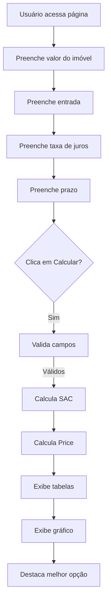

# PRD — Calculadora de Financiamento Imobiliário

**Versão:** 1.4 (draft — refatoração planejada)  
**Data:** 22 de Outubro de 2026  
**Status:** v1.3 implementado e validado; v1.4 (refatoração interna, sem mudança funcional) planejado  

---

## 1. Resumo Executivo

Desenvolvimento de uma calculadora de financiamento imobiliário, funcionando como landing page responsiva, que permite ao usuário simular financiamentos pelos sistemas SAC e Price automaticamente, visualizar tabelas de amortização, comparar custos totais e identificar a opção mais econômica.

---

## 2. Objetivo do Produto

Fornecer uma ferramenta gratuita e acessível que auxilie o consumidor final a tomar decisões informadas sobre financiamento imobiliário, comparando automaticamente os dois sistemas de amortização mais comuns do mercado brasileiro.

---

## 3. Problema

O consumidor que deseja financiar um imóvel frequentemente não compreende a diferença entre os sistemas SAC e Price, nem consegue visualizar o impacto financeiro de cada um ao longo do tempo. Isso gera decisões subótimas e possível endividamento desnecessário.

---

## 4. Objetivos de Negócio

| Objetivo | Métrica | Meta |
|----------|---------|------|
| Utilidade pública | Visitas mensais | Crescente |
| Engajamento | Tempo na página | > 2 minutos |
| Compartilhamento | Shares via WhatsApp/link | Crescente |
| Retenção | Taxa de retorno | > 30% |

---

## 5. Escopo

### 5.1 Incluído (MVP)

- Formulário de entrada com 4 campos
- Cálculo automático dos dois sistemas (SAC e Price) ao clicar em "Calcular"
- Tabela de amortização completa para cada sistema
- 4 gráficos comparativos visuais (Parcelas, Juros, Amortização, Saldo Devedor)
- Comparação do valor total em R$
- Destaque do financiamento mais econômico
- Botão "Exportar CSV" para download dos dados das tabelas
- Paginação nas tabelas (20 itens por página quando houver mais de 20 linhas)
- Design responsivo (mobile-first)

### 5.2 Fora do Escopo

- Backend ou API
- Cadastro de usuários
- Autenticação
- Salvar simulações
- Integração com bancos ou APIs de taxas
- Simulação de correção monetária (INCC, TR)
- Cálculo de custos adicionais (ITBI, cartório, seguros)
- Exportação para formatos além de CSV (PDF, XLSX)

---

## 6. Stakeholders

| Stakeholder | Papel | Responsabilidade |
|-------------|-------|------------------|
| Product Manager | Decisor | Aprovação de requisitos e prioridades |
| Equipe Técnica | Executora | Desenvolvimento e manutenção |
| Designer UI/UX | Criação | Identidade visual e experiência |
| Marketing | Divulgação | Distribuição e métricas |

---

## 7. Personas

### 7.1 Pessoa — Consumidor Final

| Atributo | Descrição |
|----------|-----------|
| Nome | Maria Silva |
| Idade | 28-45 anos |
| Perfil | Pessoa física que deseja financiar imóvel |
| Necessidade | Compreender qual sistema de financiamento é mais vantajoso |
| Frustração | Dificuldade em comparar SAC e Price visualmente |
| Dispositivo | Predominantemente smartphone |

---

## 8. User Stories

| ID | Como... | Eu quero... | Para que... | Prioridade |
|----|---------|-------------|-------------|------------|
| US-001 | Usuário | Informar os dados do financiamento | Receber simulação completa | Must |
| US-002 | Usuário | Ver tabela SAC completa | Analisar parcelas mês a mês | Must |
| US-003 | Usuário | Ver tabela Price completa | Analisar parcelas mês a mês | Must |
| US-004 | Usuário | Comparar valores totais | Saber qual sistema é mais barato | Must |
| US-006 | Usuário | Compartilhar por WhatsApp | Enviar resultado para alguém | Should |
| US-007 | Usuário | Ler conteúdo educativo | Entender diferença SAC/Price | Could |
| US-008 | Usuário | Ver gráfico comparativo | Visualizar diferença visualmente | Should |
| US-009 | Usuário | Ver gráfico de evolução dos juros | Comparar custo de juros entre SAC e Price | Should |
| US-010 | Usuário | Ver gráfico de evolução da amortização | Entender como o principal é reduzido | Should |
| US-011 | Usuário | Ver gráfico de evolução do saldo devedor | Visualizar quitação ao longo do tempo | Should |
| US-012 | Usuário | Exportar dados em CSV | Analisar em planilhas (Excel/Google Sheets) | Should |
| US-013 | Usuário | Paginar tabelas longas | Visualizar dados de forma mais organizada | Should |

---

## 9. Casos de Uso

### UC-001 — Simular Financiamento

**Ator:** Usuário  
**Pré-condição:** Página carregada  
**Fluxo Principal:**
1. Usuário informa valor do imóvel
2. Usuário informa valor da entrada
3. Usuário informa taxa de juros mensal
4. Usuário informa prazo em meses
5. Usuário clica em "Calcular"
6. Sistema calcula automaticamente SAC e Price
7. Sistema exibe tabelas SAC e Price
8. Sistema exibe gráfico comparativo
9. Sistema destaca o financiamento mais econômico

**Fluxo de Exceção:**
- Campos obrigatórios vazios → exibir mensagem de erro
- Entrada maior ou igual ao valor do imóvel → exibir mensagem de erro
- Taxa de juros igual a zero → permitir cálculo (financiamento sem juros)

---

## 10. Fluxos de Negócio



---

## 11. Requisitos Funcionais

### 11.1 Formulário de Entrada

| ID | Requisito | Prioridade | Critério de Aceite |
|----|-----------|------------|-------------------|
| FR-001 | Campo "Valor do imóvel" (numérico, R$) | Must | Aceita valores > 0, formata moeda brasileira |
| FR-002 | Campo "Entrada" (numérico, R$) | Must | Aceita valores >= 20% do imóvel, < valor do imóvel |
| FR-003 | Campo "Taxa de juros" (numérico, % a.m.) | Must | Aceita valores >= 0, com até 2 casas decimais |
| FR-004 | Campo "Prazo" (numérico, meses) | Must | Aceita valores inteiros > 0, máximo 600 meses |
| FR-006 | Botão "Calcular" | Must | Executa cálculos e exibe resultados |

### 11.2 Cálculos

| ID | Requisito | Prioridade | Critério de Aceite |
|----|-----------|------------|-------------------|
| FR-010 | Cálculo SAC automático | Must | Amortização constante + juros sobre saldo devedor |
| FR-011 | Cálculo Price automático | Must | Parcelas fixas com juros amortizados |
| FR-012 | Cálculo ambos os sistemas | Must | Sempre calcula SAC e Price juntos |
| FR-013 | Valor financiado = Valor imóvel - Entrada | Must | Cálculo correto |
| FR-014 | Total pago = soma de todas as parcelas | Must | Inclui amortização + juros |
| FR-015 | Custo total dos juros = Total pago - Valor financiado | Must | Diferença correta |
| FR-016 | Geração de dados para CSV | Should | Gera string CSV com cabeçalhos: Mês, Amortização, Juros, Parcela, Saldo Devedor |

### 11.3 Resultados

| ID | Requisito | Prioridade | Critério de Aceite |
|----|-----------|------------|-------------------|
| FR-020 | Tabela SAC completa | Must | Mês, Amortização, Juros, Parcela, Saldo Devedor |
| FR-021 | Tabela Price completa | Must | Mês, Amortização, Juros, Parcela, Saldo Devedor |
| FR-022 | Comparação do valor total | Must | Exibe total SAC vs total Price em R$ |
| FR-023 | Destaque do mais econômico | Must | Indica visualmente qual sistema custa menos |
| FR-024 | Gráfico comparativo | Should | Barra ou linha mostrando evolução das parcelas |
| FR-025 | Compartilhar via WhatsApp | Should | Abre WhatsApp com mensagem formatada |
| FR-026 | Gráfico comparativo de juros | Should | Gráfico de linha mostrando evolução dos juros SAC vs Price |
| FR-027 | Gráfico comparativo de amortização | Should | Gráfico de linha mostrando evolução da amortização SAC vs Price |
| FR-028 | Gráfico comparativo de saldo devedor | Should | Gráfico de linha mostrando evolução do saldo devedor SAC vs Price |
| FR-029 | Botão exportar CSV | Should | Exporta dados de SAC e Price em formato CSV separado por ponto e vírgula |
| FR-030 | Paginação de tabelas | Should | Tabelas com paginação de 20 itens quando ultrapassar 20 linhas |

### 11.4 Conteúdo Educativo

| ID | Requisito | Prioridade | Critério de Aceite |
|----|-----------|------------|-------------------|
| FR-030 | Explicação SAC | Could | Texto claro sobre como funciona o SAC |
| FR-031 | Explicação Price | Could | Texto claro sobre como funciona o Price |
| FR-032 | Diferenças SAC vs Price | Could | Quadro comparativo textual |

### 11.5 Melhorias implementadas além do escopo inicial (v1.3)

| ID | Requisito | Critério de Aceite | Onde |
|----|-----------|-------------------|------|
| FR-033 | Ponto de equilíbrio SAC vs Price | Exibe "a partir do NNNº mês a parcela SAC fica menor que a Price" | `FinancingComparison.tsx` (`mesCruzamento`) |
| FR-034 | Percentual de economia | Exibe `-X,X%` ao lado da economia em R$ | `FinancingComparison.tsx` (`percentualEconomia`) |
| FR-035 | Taxa anual equivalente | Exibe `≈ X,XX% a.a.` a partir da taxa mensal | `FormCalculator.tsx` (`taxaAnualEquivalente`) |
| FR-036 | Atalhos de entrada e prazo | Botões 20/30/40/50% e 120/240/360/420m preenchem o campo | `FormCalculator.tsx` |
| FR-037 | Preview do valor financiado | Exibe `Valor a financiar (Principal)` + % do imóvel antes de calcular | `FormCalculator.tsx` (`valorFinanciadoPreview`) |
| FR-038 | Composição amortização/juros | Donut/texto `Amortização: X% / Juros: Y%` por sistema | `ResultHeader.tsx` |
| FR-039 | Lazy loading + animação de entrada | `Comparacao`/`Educativo` via `lazy`+`Suspense`, `FadeIn` | `App.tsx`, `ui/FadeIn.tsx` |

---

## 12. Requisitos Não Funcionais

| ID | Requisito | Prioridade | Critério de Aceite | Status em 22/10/2026 |
|----|-----------|------------|-------------------|----------------------|
| NFR-001 | Performance | Must | Cálculos em < 100ms no navegador | Não medido em runtime; build Vite em 153ms — remover meta ou medir com `performance.now()` |
| NFR-002 | Responsividade | Must | Funciona em telas de 320px a 2560px | Implementado (mobile-first, validado em 390px em 22/10/2026) |
| NFR-003 | Compatibilidade | Must | Chrome, Firefox, Safari, Edge (últimas 2 versões) | Não testado formalmente — pendente |
| NFR-004 | Acessibilidade | Should | Inputs com labels, contraste adequado | Implementado (`aria-label`, `tablist`, labels em `FormField`) — sem auditoria formal |
| NFR-005 | SEO | Could | Meta tags, título descritivo | Implementado (`index.html`: title, description, OG, Twitter, theme-color) |
| NFR-006 | Peso da página | Must | < 500KB total (sem imagens externas) | Atendido: `dist/` 464KB (22/10/2026). Obs: usa Google Fonts externas |

---

## 13. Regras de Negócio

| ID | Regra |
|----|-------|
| RN-001 | Entrada deve ser ≥ 20% e menor que o valor do imóvel |
| RN-002 | Taxa de juros pode ser zero (financiamento sem juros) |
| RN-003 | Prazo máximo de 600 meses (50 anos) |
| RN-004 | Valores monetários arredondados para 2 casas decimais |
| RN-005 | Tabelas devem mostrar todos os meses do prazo informado |
| RN-006 | O sistema mais econômico é o que menor valor total apresentar |

---

## 14. Modelo de Domínio

```
Financiamento
├── valorImovel: number
├── entrada: number
├── taxaJuros: number
├── prazoMeses: number
├── valorFinanciado: number
├── resultadoSAC: Resultado
└── resultadoPrice: Resultado

Resultado
├── totalPago: number
├── totalJuros: number
├── parcelaInicial: number
├── parcelaFinal: number
└── tabela: Parcela[]

Parcela
├── mes: number
├── amortizacao: number
├── juros: number
├── parcela: number
└── saldoDevedor: number
```

---

## 15. Integrações

Nenhuma integração externa necessária. Todos os cálculos são realizados localmente no navegador.

---

## 16. APIs

Não aplicável — aplicação 100% frontend.

---

## 17. Modelo de Dados Conceitual

```
┌─────────────────────────────────────────────┐
│              ENTRADA                        │
├─────────────────────────────────────────────┤
│  valorImovel: R$ X.XXX,XX                   │
│  entrada: R$ X.XXX,XX                       │
│  valorFinanciado: R$ X.XXX,XX               │
│  taxaJuros: X,XX% a.m.                      │
│  prazoMeses: XXX meses                      │
└─────────────────────────────────────────────┘
                    │
                    ▼
┌─────────────────────────────────────────────┐
│              RESULTADO                      │
├─────────────────────────────────────────────┤
│  SAC                                        │
│  ├── totalPago: R$ X.XXX,XX                 │
│  ├── totalJuros: R$ X.XXX,XX                │
│  └── tabela: [Parcela, ... Parcela]         │
├─────────────────────────────────────────────┤
│  PRICE                                      │
│  ├── totalPago: R$ X.XXX,XX                 │
│  ├── totalJuros: R$ X.XXX,XX                │
│  └── tabela: [Parcela, ... Parcela]         │
├─────────────────────────────────────────────┤
│  COMPARAÇÃO                                 │
│  ├── melhorOpcao: SAC | PRICE               │
│  └── economia: R$ X.XXX,XX                  │
└─────────────────────────────────────────────┘
```

---

## 18. Permissões

Não aplicável — não há autenticação ou perfis de usuário.

---

## 19. Critérios de Aceite

| ID | Critério |
|----|----------|
| CA-001 | Formulário valida campos obrigatórios antes de calcular |
| CA-002 | Tabela SAC exibe todos os meses com valores corretos |
| CA-003 | Tabela Price exibe todos os meses com valores corretos |
| CA-004 | Comparação mostra valores totais lado a lado |
| CA-005 | Sistema mais econômico é destacado visualmente |
| CA-007 | Compartilhar abre WhatsApp com mensagem formatada |
| CA-008 | Página funciona em dispositivos móveis |
| CA-009 | Cálculos são precisos (comparação com planilha de referência) |
| CA-010 | Gráfico de juros exibe evolução correta SAC vs Price |
| CA-011 | Gráfico de amortização exibe evolução correta SAC vs Price |
| CA-012 | Gráfico de saldo devedor exibe evolução correta SAC vs Price |
| CA-013 | Botão CSV exporta dados corretos de ambas as tabelas |
| CA-014 | Paginação funciona corretamente com 20 itens por página |
| CA-015 | CSV gerado é válido e pode ser importado em Excel/Google Sheets |

---

## 20. MVP

### Versão 1.0 (MVP)

- Formulário com 4 campos
- Cálculo automático SAC + Price
- Botão Calcular
- Tabelas completas para ambos os sistemas
- 4 gráficos comparativos (Parcelas, Juros, Amortização, Saldo Devedor)
- Comparação do valor total
- Destaque do mais econômico
- Botão exportar CSV (ambas as tabelas)
- Paginação de tabelas (20 itens por página)
- Design responsivo

### Versão 1.1

- Compartilhar via WhatsApp
- Conteúdo educativo

### Versão 1.2

- Animações de transição
- SEO otimizado
- Analytics

---

## 21. Roadmap

| Fase | Entregas | Estimativa |
|------|----------|------------|
| Fase 1 — MVP | Estrutura HTML + CSS + JS, formulário, cálculos, tabelas, comparação | Sem prazo definido |
| Fase 2 — Extras | Gráficos, compartilhamento, conteúdo educativo | Sem prazo definido |
| Fase 3 — Polish | Animações, SEO, analytics | Sem prazo definido |

---

## 22. Métricas de Sucesso

| Métrica | Indicador | Meta |
|---------|-----------|------|
| Utilidade | Visitas mensais | Crescente |
| Engajamento | Tempo médio na página | > 2 minutos |
| Precisão | Acerto dos cálculos | 100% |
| Compartilhamento | Shares via WhatsApp | Crescente |
| Retorno | Taxa de retorno | > 30% |

---

## 23. Riscos

| Risco | Impacto | Probabilidade | Mitigação |
|-------|---------|---------------|-----------|
| Erro nos cálculos financeiros | Alto | Média | Validação com planilha de referência |
| Incompatibilidade entre browsers | Médio | Baixa | Testes nos 4 browsers principais |
| Performance em prazos longos (600 meses) | Baixo | Baixa | Otimização de loops |
| UX confusa em mobile | Médio | Média | Testes de usabilidade |

---

## 24. Dependências

| Dependência | Tipo | Status |
|-------------|------|--------|
| Biblioteca de gráficos (Chart.js) | Externa | Obrigatória (Fase 1) |
| Geração de CSV | Interna | Obrigatória (Fase 1) |

---

## 25. Dívidas Técnicas

| Item | Status em 22/10/2026 |
|------|----------------------|
| 31 arquivos modificados não commitados + 5 paths untracked (`public/og-image.svg`, `__tests__/`, `test/`, `docs/`) | Pendente — fazer commit por sprint ou squash com mensagem por escopo |
| `typescript: ~6.0.2` (versão fora do stable público) + churn em `package-lock.json` (1658 linhas) | Pendente — avaliar pinagem em TS 5.x |
| NFR-001/NFR-003 sem evidência formal (performance runtime, cross-browser) | Pendente — medir e registrar |

---

## 26. Dúvidas em Aberto

| Dúvida | Status |
|--------|--------|
| Usar Chart.js ou gráfico customizado em CSS? | Resolvido — Chart.js + react-chartjs-2 (`LineChart.tsx`) |
| Compartilhar via link externo ou apenas WhatsApp? | Resolvido — apenas WhatsApp (`WhatsAppShareButton.tsx`) |
| Necessário testar em navegadores antigos? | Resolvido — escopo: últimas 2 versões (NFR-003, sem teste formal ainda) |

---

## 27. Fórmulas de Cálculo

### SAC (Sistema de Amortização Constante)

```
Amortização = Valor Financiado / Prazo
Juros = Saldo Devedor * Taxa Mensal
Parcela = Amortização + Juros
Saldo Devedor = Saldo Anterior - Amortização
```

### Price (Tabela Price)

```
Parcela = VP * [i * (1+i)^n] / [(1+i)^n - 1]
Onde:
  VP = Valor Financiado
  i = Taxa mensal
  n = Prazo em meses
```

### Geração de CSV

**Estrutura do arquivo:**
- Separador: ponto e vírgula (;)
- Encoding: UTF-8
- Cabeçalhos: Mês, Amortização, Juros, Parcela, Saldo Devedor
- Separador decimal: vírgula (,) para compatibilidade brasileira
- Separador de milhar: ponto (.)

**Seções no arquivo:**
1. SAC — TABELA DE AMORTIZAÇÃO
2. PRICE — TABELA DE AMORTIZAÇÃO

---

## Checklist de Completude

- [x] Resumo Executivo
- [x] Objetivo do Produto
- [x] Problema
- [x] Objetivos de Negócio
- [x] Escopo
- [x] Fora do Escopo
- [x] Stakeholders
- [x] Personas
- [x] User Stories
- [x] Casos de Uso
- [x] Fluxos de Negócio
- [x] Requisitos Funcionais
- [x] Requisitos Não Funcionais
- [x] Regras de Negócio
- [x] Modelo de Domínio
- [x] Integrações
- [x] APIs
- [x] Modelo de Dados Conceitual
- [x] Permissões
- [x] Critérios de Aceite
- [x] MVP
- [x] Roadmap
- [x] Métricas de Sucesso
- [x] Riscos
- [x] Dependências
- [x] Dívidas Técnicas
- [x] Dúvidas em Aberto
- [x] Fórmulas de Cálculo
- [x] Gráficos adicionais (juros, amortização, saldo devedor)
- [x] Exportação CSV
- [x] Paginação de tabelas
- [ ] Plano de refatoração e modularização (v1.4, sem mudança funcional)

---

## 28. Plano de Refatoração e Modularização (v1.4 — sem mudança funcional)

**Motivador (decisão 22/10/2026):** manutenibilidade. **Escopo:** só refatoração segura — nenhuma mudança visual/comportamental. **Estratégia:** incremental por fases, cada fase reversível e coberta por testes. Detalhamento executável em `SPRINTS.md` (Sprints 13–18).

### 28.1 Diagnóstico (base: auditoria 22/10/2026, ~2.262 linhas sem testes)

| Achado | Onde | Impacto |
|--------|------|---------|
| Lógica derivada dentro de UI (sem cobertura) | `FinancingComparison.tsx:19-37` (`mesCruzamento`, `%economia`), `ResultHeader.tsx:19-25` (`principal`), `FormCalculator.tsx:34-62` (`taxaAnual`, `prazoAnos`, `preview`, `%entrada`) | Baixa testabilidade, risco de divergência |
| Parsing de moeda/percentual duplicado (6 ocorrências) | `useFormCalculator.ts:37-38,157-158` + `FormCalculator.tsx:29-31` | Drift de formato; gotcha máscara `/100` (`format.ts`) |
| Validação acoplada a formatação | `useFormCalculator.ts:53` chama `formatarEntradaMoeda()` dentro de `validate()`; `handleChange:104-118` vs `handleBlur:126-142` quase idênticas | Teste frágil, validador não reutilizável |
| Componentes grandes (>200 linhas) | `EducationalContent.tsx:286`, `FinancingComparison.tsx:244`, `FormCalculator.tsx:228` (+ `PainelSAC` vs `PainelPrice` JSX idêntico) | Difícil revisar/testar |
| Anti-patterns isolados | `AmortizationTable.tsx:17-20` (`setState` durante render), `LineChart.tsx:17-26,90-167` (`ChartJS.register()` em módulo + `options` ignora `rotuloEixoY`), `InputField` com `forwardRef` legado (desnecessário no React 19) | Extra render em `StrictMode`, prop morta |
| Mistura puro/impuro + over-segmentação | `csv.ts:46` (`downloadCSV` com DOM junto da geração), `sharing/` com 1 arquivo de 60 linhas, barrels inconsistentes | Dificulta mock/teste |

### 28.2 Princípios e restrições globais (valem para Sprints 13–18)

- Fluxo mantido: `components → hooks → utils → types`, sem ciclos. `components` só renderizam; todo cálculo vai para `utils/` puro.
- Regras de negócio imutáveis: entrada ≥ 20% e < valor (RN-001), taxa 0–20%/mês, prazo 1–600 (RN-002/RN-003), arredondamento 2 casas com ajuste na última parcela (RN-004), CSV pt-BR `;` + `,` + `BOM \uFEFF` + seções `SAC —/Price —`.
- Load-bearing intocável sem migração dedicada: `vite.config.ts` (`globals:true`, `jsdom`, `setupFiles:./src/test/setup.ts`, `css:true`), máscara `/100`, mensagens pt-BR.
- Núcleo `calculations.ts` (SAC/Price/Totais/comparar) não muda na refatoração; invariantes travadas: `parcela = amort + juros`, `total - juros = principal`, `SAC.juros < Price.juros`.
- Comandos de verificação por fase (em `calculadora-fi/`): `npx vitest run <escopo>`, `npm run lint`, `npm run format:check`, `npm run build` (`tsc -b && vite build`).

### 28.3 Arquitetura-alvo (sem mudar UX)

```text
src/
  constants/business.ts      # ENTRADA_MINIMA=0.2, TAXA_MAXIMA=20, PRAZO_MAXIMO=600, ITENS_POR_PAGINA=20, atalhos
  utils/
    format.ts               # + parseMoedaParaNumero(), parsePercentualParaNumero(), formatarPercentual()
    calculations.ts             # inalterado no núcleo
    analysis.ts              # NOVO puro: mesCruzamento(), percentualEconomia(), valorPrincipal(), taxaAnualEquivalente(), prazoEmAnos(), percentualEntrada()
    csv.ts                  # só geração pura; downloadCSV → csvDownload.ts (DOM)
    chart.ts                # NOVO: cores SAC/PRICE + chartOptions() + registerChart()
  domain/validation.ts       # NOVO puro: validateFinanciamento(números) sem máscara/formatação
  components/
    form/ (container + CamposFormulario + DownPaymentShortcuts/TermShortcuts + PrincipalPreview)
    results/ (FinancingComparison orquestra + RecommendationCard + ChartsGrid + TableTabs)
    education/ (content.ts + SystemPanel unificado + ComparisonTable + EducationTabs)
    layout/ + SimulationCard.tsx (extraído de App.tsx:32-58)
```

### 28.4 Fases (resumo; tarefas e DoD em SPRINTS.md)

| Fase | Sprint | Entrega |
|------|--------|---------|
| Fase 0 — Trava de segurança | Sprint 13 | Testes de caracterização do comportamento atual (sem código produtivo) |
| Fase 1 — Derivados puros | Sprint 14 | `utils/analysis.ts` + testes; UI consome (remove lógica de `Comparacao/ResultadoHeader/Form`) |
| Fase 2 — Parsing único | Sprint 15 | `parseMoeda/Percentual` em `format.ts`; substitui 6 ocorrências + `toLocaleString` ad-hoc |
| Fase 3 — Validação pura | Sprint 16 | `constants/business.ts` + `domain/validation.ts`; hook vira adaptador fino |
| Fase 4 — Fatiar componentes + 2 bugfixes seguros | Sprint 17 | Sub-componentes + `useEffect` em `Tabela` + `options` do `Grafico` + sem `forwardRef` |
| Fase 5 — Higiene | Sprint 18 | Barrels consistentes, split `csv`, `chart.ts`, `sharing`, `oxlint`, limpeza `user-event` se morto |

### 28.5 Requisitos de refatoração

| ID | Requisito | Critério de aceite |
|----|-----------|-------------------|
| RFR-001 | Nenhuma mudança visual/funcional | Screenshots e fluxos US-001–US-013 inalterados; testes existentes continuam passando sem ajuste de snapshot |
| RFR-002 | Lógica derivada 100% em funções puras testadas | `mesCruzamento`, `%economia`, `principal`, `taxaAnual`, `prazoAnos`, `preview` cobertos em `analysis.test.ts` |
| RFR-003 | Parsing centralizado | Uma única implementação de parse moeda/percentual; zero ocorrências de `replace(/\./g,'')` fora de `format.ts` |
| RFR-004 | Validação pura reutilizável | `validateFinanciamento` sem importar `format.ts`; mensagem formatada injetada pelo hook |
| RFR-005 | Componentes ≤ ~150 linhas cada (alvo) | `Comparacao/Form/Educativo` fatiados; nenhum arquivo novo >150 linhas sem justificativa |
| RFR-006 | Sem `setState` durante render | `TabelaAmortizacao` usa `useEffect` ou `key`; sem warning em `StrictMode` |

### 28.6 Riscos

| Risco | Mitigação |
|-------|-----------|
| Quebrar arredondamento/invariantes | Fase 1 não toca núcleo; caracterização trava totais antes |
| Mensagem de erro com formato quebra teste | Validador recebe número; hook formata |
| Canvas `chart.js` quebra `jsdom` | Sem teste de canvas novo; manter `memo/useMemo` |

**Status do PRD:** v1.3 implementado e validado em 22/10/2026 (53 testes Vitest passando, build limpo, `dist/` 464KB). v1.4 (refatoração, §28 + Sprints 13–18) planejado em 22/10/2026, sem mudança funcional.
