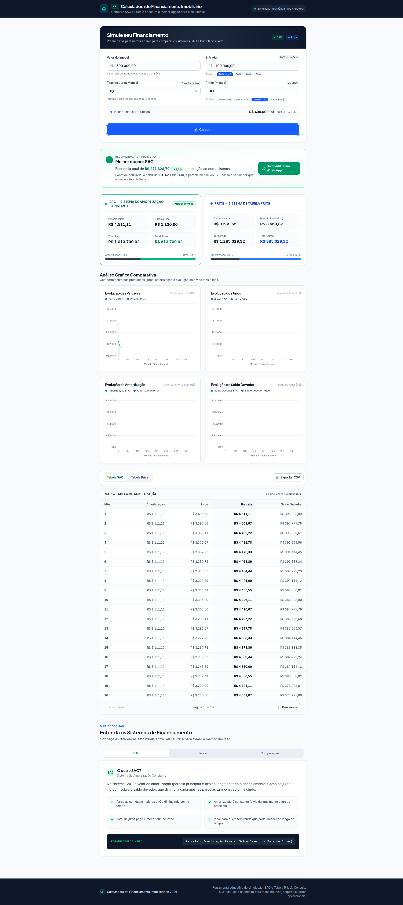
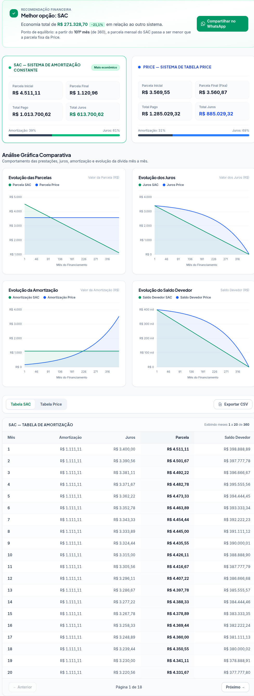
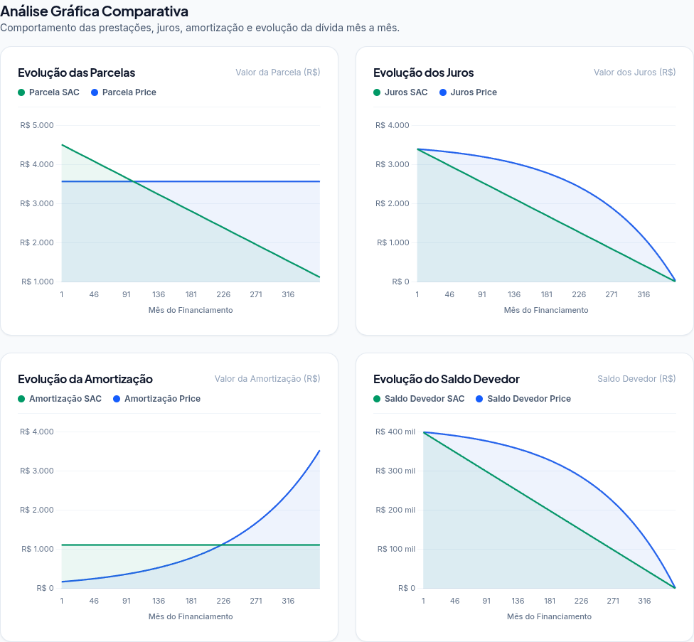
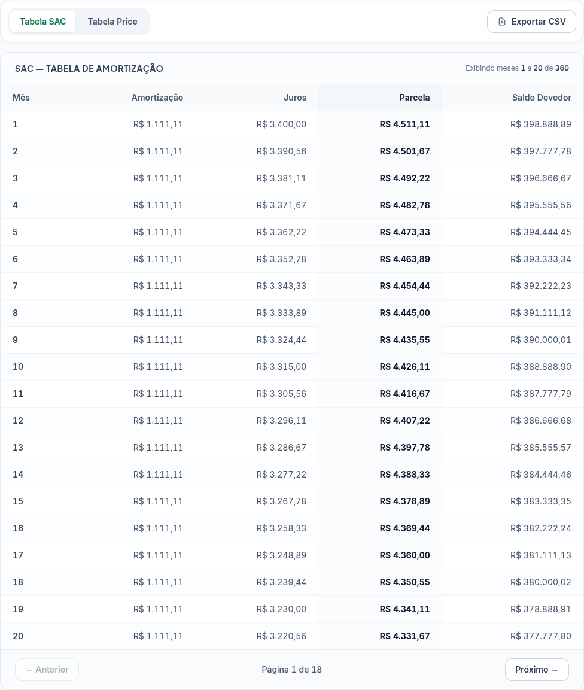
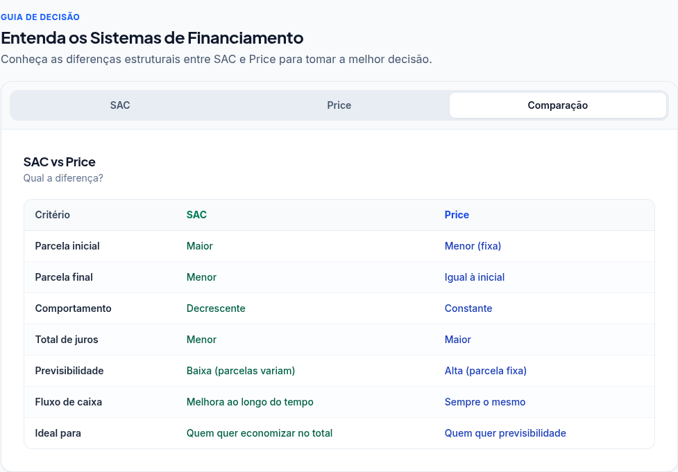

# CFI — Calculadora de Financiamento Imobiliário


Ferramenta gratuita e 100% frontend para simular e comparar financiamentos imobiliários nos sistemas **SAC e Price**. Calcule parcelas, juros totais, visualize 4 gráficos, exporte CSV e compartilhe via WhatsApp.

> Exemplo real: imóvel R$ 500.000, entrada R$ 100.000, 0,85% a.m., 360 meses → SAC economiza **R$ 271.328,70 (-21,1%)** vs Price.



## Índice

- [Features](#features)
- [Demo / Screenshots](#demo--screenshots)
- [Stack](#stack)
- [Pré-requisitos](#pré-requisitos)
- [Início rápido](#início-rápido)
- [Como usar](#como-usar)
- [Scripts](#scripts)
- [Estrutura do projeto](#estrutura-do-projeto)
- [Regras de negócio](#regras-de-negócio)
- [Testes e qualidade](#testes-e-qualidade)
- [Documentação](#documentação)
- [Roadmap](#roadmap)
- [Contribuição](#contribuição)
- [Licença](#licença)

## Features

- Formulário com validação completa (entrada mín. 20%, taxa 0-20%, prazo 1-600 meses)
- Cálculo automático **SAC + Price** lado a lado, 100% local no navegador
- Cards comparativos com destaque do mais econômico + ponto de equilíbrio
- 4 gráficos Chart.js: Parcelas, Juros, Amortização, Saldo Devedor
- Tabelas de amortização com paginação (20 itens/página)
- Exportação CSV formato brasileiro (`;` + `,` decimal, UTF-8)
- Compartilhamento via WhatsApp com mensagem formatada
- Conteúdo educativo: SAC, Price e tabela comparativa
- Responsivo mobile-first (320px → 2560px), SEO + Open Graph

## Demo / Screenshots

Todas as imagens em `docs/screenshots/` — capturas reais do app rodando em `http://localhost:5173`.

### 1. Formulário inicial


Campos com máscara pt-BR, atalhos de entrada (20/30/40/50%) e prazo (10/20/30/35 anos), preview do valor a financiar.

### 2. Comparação e recomendação



Recomendação financeira + cards SAC/Price com parcela inicial/final, total pago e total juros, composição amortização/juros.

### 3. Análise gráfica



4 gráficos de linha responsivos com tooltip interativo.

### 4. Tabela de amortização + CSV



Colunas Mês, Amortização, Juros, Parcela, Saldo Devedor. Botão `Exportar CSV` gera SAC + Price no mesmo arquivo.

### 5. Conteúdo educativo



Abas SAC / Price / Comparação com fórmulas e quadro decisório.

## Stack

| Camada | Tecnologia | Versão |
|--------|------------|--------|
| UI | React + TypeScript | 19 + ~6.0 (`typescript: ~6.0.2` no `package.json`) |
| Bundler | Vite | 8 |
| Estilos | Tailwind CSS | 4.3 |
| Gráficos | Chart.js + react-chartjs-2 | 4.5 + 5.3 |
| Testes | Vitest + Testing Library + jsdom | 5.0 + 16.3 |
| Qualidade | OxLint + Prettier | 1.71 + 3.9 |
| Fontes | Inter + Plus Jakarta Sans (Google Fonts) | — |

Sem backend. Todos os cálculos são locais no navegador.

## Pré-requisitos

- Node.js 20+ (Vite 8 exige Node 20.19+ / 22.12+)
- npm 10+

Verifique com:

```bash
node --version
npm --version
```

## Início rápido

O app vive em `calculadora-fi/`:

```bash
cd calculadora-fi

# Instale as dependências
npm install

# Servidor de desenvolvimento
npm run dev
```

Acesse `http://localhost:5173`.

Build de produção:

```bash
npm run build
npm run preview
```

## Como usar

1. Preencha **Valor do Imóvel** (ex: `500.000,00`)
2. Preencha **Entrada** — mínimo 20% (ex: `100.000,00`)
3. Informe **Taxa de Juros Mensal** (ex: `0,85` → ≈10,69% a.a.)
4. Informe **Prazo** (ex: `360` meses = 30 anos)
5. Clique em **Calcular**

Resultado esperado para o exemplo acima (validado no app):

| Sistema | Parcela inicial | Parcela final | Total pago | Total juros |
|---------|----------------|---------------|------------|-------------|
| SAC | R$ 4.511,11 | R$ 1.120,96 | R$ 1.013.700,62 | R$ 613.700,62 |
| Price | R$ 3.569,55 fixa | R$ 3.560,87 | R$ 1.285.029,32 | R$ 885.029,32 |

Ponto de equilíbrio: a partir do **101º mês**, a parcela SAC fica menor que a Price.

CSV exportado:

```
SAC — TABELA DE AMORTIZAÇÃO
Mês;Amortização;Juros;Parcela;Saldo Devedor
1;1.111,11;3.400,00;4.511,11;398.888,89
...
PRICE — TABELA DE AMORTIZAÇÃO
...
```

Compatível com Excel / Google Sheets (separador `;`, decimal `,`).

## Scripts

Execute dentro de `calculadora-fi/`:

| Comando | Descrição |
|---------|-----------|
| `npm run dev` | Servidor dev Vite (HMR) |
| `npm run build` | `tsc -b` + build Vite para `dist/` |
| `npm run preview` | Preview da build |
| `npm run test` | Vitest run (unitários SAC/Price, CSV, validação) |
| `npm run test:watch` | Vitest watch |
| `npm run lint` | OxLint |
| `npm run lint:fix` | OxLint com autofix |
| `npm run format` | Prettier write em `src/` |
| `npm run format:check` | Prettier check |

## Estrutura do projeto (resumida — app + docs)

```
.
├── calculadora-fi/          # Aplicação React+Vite
│   ├── src/
│   │   ├── components/
│   │   │   ├── education/   # Conteúdo SAC/Price/Comparação
│   │   │   ├── form/        # FormCalculator (+ __tests__/)
│   │   │   ├── layout/      # Header, Main, Footer
│   │   │   ├── results/     # Comparação, gráficos, tabelas, CSV, WhatsApp (+ __tests__/)
│   │   │   └── ui/          # FormField, InputField, Pagination, FadeIn
│   │   ├── hooks/           # useFinancing, useFormCalculator (+ __tests__/)
│   │   ├── types/           # Financiamento, Resultado, Parcela
│   │   ├── utils/           # calculations, format, csv (+ __tests__/)
│   │   ├── test/            # setup Vitest
│   │   ├── App.tsx
│   │   ├── main.tsx
│   │   └── index.css
│   ├── public/              # favicon.svg, og-image.svg
│   ├── .oxlintrc.json / .prettierrc
│   ├── vite.config.ts
│   ├── dist/                # build (gerado, 460KB em 22/10/2026)
│   └── package.json
├── docs/
│   └── screenshots/         # Prints usados neste README
│       ├── 01-form-inicial.png
│       ├── 02-resultado-comparacao.png
│       ├── 02a-cards-comparacao.png
│       ├── 03-graficos.png
│       ├── 04-tabela.png
│       └── 05-educativo.png
├── LICENSE                  # MIT
└── README.md                # Este arquivo
```

> Documentos de produto em `PRD.md` (v1.5) e `SPRINTS.md` (Sprints 1-22) — ver `## Documentação`.

Fórmulas:

- **SAC:** `Amortização = VP/n | Juros = Saldo × i | Parcela = Amortização + Juros`
- **Price:** `Parcela = VP × [i(1+i)^n] / [(1+i)^n – 1]`

## Regras de negócio

- Entrada ≥ 20% e < valor do imóvel
- Taxa pode ser 0% (sem juros), máx. 20% a.m.
- Prazo 1–600 meses
- Arredondamento 2 casas decimais
- Mais econômico = menor total pago

Validações exibem mensagens em pt-BR no formulário.

## Testes e qualidade

```bash
cd calculadora-fi
npm run test        # 123/123 Vitest passando (10 arquivos) — verificado em 22/10/2026
npm run lint        # oxlint limpo — verificado em 22/10/2026
npm run format:check
npm run build       # tsc -b + vite build OK — dist/ 460KB (<500KB) em 22/10/2026
```

Critérios DoD por sprint: testes passando, build limpo, responsivo (validado em 390px em 22/10/2026; faixa total 320–2560 e cross-browser ainda sem teste formal — ver `SPRINTS.md`).

Para regenerar os screenshots:

```bash
npm run dev  # :5173
# No formulário, digite os centavos sem máscara:
# Valor do Imóvel: 50000000 → R$ 500.000,00
# Entrada: 10000000 → R$ 100.000,00
# Taxa: 085 → 0,85 | Prazo: 360 → Calcular → print
# salvar em docs/screenshots/
```

## Documentação

- `PRD.md` v1.5 — visão, personas, FR/NFR (+FR-033 a FR-039 pós-MVP), fórmulas, refatoração v1.4 (§28) e plano de Dockerização v1.5 (§29, requisitos DKR-001 a DKR-008)
- `SPRINTS.md` — Sprints 1–18 implementadas (123 testes / 10 arquivos) + Sprints 19–22 (Dockerização multi-stage + Nginx non-root + Docker Compose) planejadas
- `calculadora-fi/README.md` — README técnico resumido do app

## Roadmap

- [x] Sprints 1-5: setup, form, cálculos, tabelas, comparação
- [x] Sprints 6-7: gráficos + WhatsApp + educativo
- [x] Sprints 9-11: paginação, +3 gráficos, CSV
- [x] Sprint 8: SEO, OG tags, acessibilidade, performance
- [x] Sprints 12-18: refinos pós-MVP + refatoração modular v1.4 (123 testes)
- [ ] Sprints 19-22: Dockerização multi-stage (`node:22-alpine` + `nginx-unprivileged`) e Docker Compose
- [ ] PWA / salvar simulações localStorage
- [ ] Comparar com correção INCC/TR
- [ ] Exportar PDF/XLSX
- [ ] Incluir ITBI, cartório, seguros no custo total

## Contribuição

1. Fork + branch `feat/minha-feature`
2. `cd calculadora-fi && npm install`
3. Implemente + adicione testes Vitest
4. `npm run lint && npm run format && npm run test && npm run build`
5. Abra PR com descrição e screenshots

Padrão: TypeScript estrito, componentes funcionais, Tailwind utility-first, mensagens em pt-BR.

## Licença

Este projeto está licenciado sob a [MIT License](LICENSE) — © 2026 CFI Contributors.
